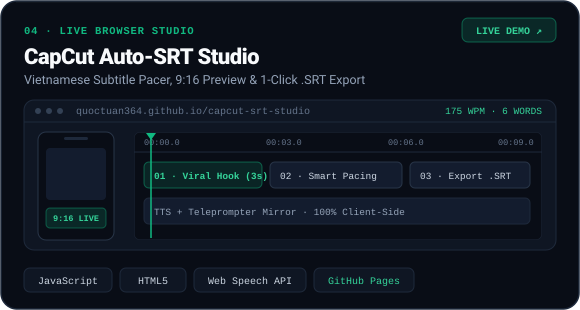

  

  

    <a href="mailto:Tuanisme362004@gmail.com">Email (Tuanisme362004@gmail.com)</a>
    &nbsp;&middot;&nbsp;
    <a href="https://www.instagram.com/lnqtuan/">Instagram (@lnqtuan)</a>
    &nbsp;&middot;&nbsp;
    <a href="https://quoctuan364.github.io/capcut-srt-studio/">Live Studio Demo</a>
    &nbsp;&middot;&nbsp;
    <a href="https://quoctuan364.github.io/quoctuan364/">Interactive Playground</a>
    &nbsp;&middot;&nbsp;
    <a href="https://github.com/quoctuan364?tab=repositories">All Repositories</a>
  

---

### Selected Work

  
  

  
  

---

### Additional Systems

- **[Product-Security](https://github.com/quoctuan364/Product-Security)** — Fail-closed, zero-trust file scanning gateway with isolated container hardening (`Python`, `Docker`, `AppSec`).
- **[MindVault](https://github.com/quoctuan364/mindvault)** — Local-first Second Brain &amp; 2D physics knowledge graph OS (`Node.js`, `SQLite WAL`, `JavaScript`).
- **[ChannelCorp OS](https://github.com/quoctuan364/channelcorp-os)** — Multi-agent content production pipeline across 5 coordinated AI departments (`Node.js`, `SQLite`).
