  

  

  

    
    
    
    
  

## 👨‍💻 Giới thiệu ngắn

Mình là **Quốc Tuấn**, một **Web & Mobile Developer** tập trung vào giao diện hiện đại, trải nghiệm mượt và khả năng kết nối sản phẩm với API, dữ liệu.

- 🎨 Xây dựng giao diện Web với **React, Next.js, TypeScript và Tailwind CSS**.
- 📱 Phát triển ứng dụng Mobile với **React Native và Expo**.
- 🔌 Làm việc với **FastAPI, PostgreSQL** và tích hợp các tính năng AI vào sản phẩm.
- 🌱 Luôn học thêm ngôn ngữ, công nghệ mới và cải thiện kỹ năng qua dự án thực tế.

## 🧩 Ngôn ngữ đã học & sử dụng

  
    
  <strong>HTML · CSS · JavaScript · TypeScript · Python · Java · C# · C++</strong>

## ⚙️ Framework & công cụ

  

 

| Mảng | Công nghệ |
| :--- | :--- |
| **Web** | React · Next.js · Tailwind CSS |
| **Mobile** | React Native · Expo |
| **API & dữ liệu** | FastAPI · Node.js · PostgreSQL · Prisma |
| **AI ứng dụng** | pandas · scikit-learn · RAG |
| **Kiểm thử & công cụ** | Playwright · pytest · Docker · Git |

## 🚀 Dự án nổi bật

| Dự án | Điểm nổi bật | Công nghệ |
| :--- | :--- | :--- |
| **[BookVerse AI](https://github.com/quoctuan364/bookverse-ai)** | Nền tảng đọc và khám phá sách đa nền tảng, tích hợp gợi ý sách và trợ lý AI. | Next.js · FastAPI · PostgreSQL · Expo |
| **[Customer Segmentation](https://github.com/quoctuan364/customer-segmentation-kmeans-streamlit)** | Phân cụm khách hàng và trực quan hóa kết quả tương tác. | Python · K-Means · Streamlit |
| **[Diabetes Prediction](https://github.com/quoctuan364/diabetes-prediction-streamlit)** | Ứng dụng dự đoán hỗ trợ khám phá quy trình machine learning. | Python · scikit-learn · Streamlit |

## 📊 GitHub Dashboard

  
  
   
  
   
  

## 🤝 Kết nối

Mình luôn sẵn sàng trao đổi về **Web, Mobile, API và AI ứng dụng**. Hãy xem các repository hoặc liên hệ với mình qua những nút ở đầu trang.
