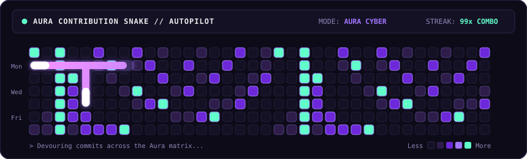

  

    

  

  

    
    
    
    
  

 

  

 

## Tech Stack & Craft

  
    
  

 

<table width="100%">
  <tr>
    <td width="33%" valign="top">
      <h4>Frontend & Mobile</h4>
      
Thiết kế giao diện chuẩn xác từng pixel, chuyển động mượt trên cả trình duyệt và thiết bị di động với <code>React</code>, <code>Next.js</code>, <code>Tailwind CSS</code> và <code>Expo</code>.

    </td>
    <td width="33%" valign="top">
      <h4>Backend & Database</h4>
      
Xây dựng RESTful API gọn nhẹ, tối ưu truy vấn và bảo toàn dữ liệu với <code>Node.js</code>, <code>FastAPI</code>, <code>PostgreSQL</code> và <code>SQLite</code>.

    </td>
    <td width="33%" valign="top">
      <h4>AI & Automation</h4>
      
Tích hợp mô hình ngôn ngữ lớn (LLM), hệ thống truy xuất tri thức <code>RAG</code>, luồng <code>Multi-Agent</code> và phân tích dữ liệu bằng <code>Python</code>.

    </td>
  </tr>
</table>

 

## Contribution Snake Arcade

  

 

## Activity & Streak

  
  
   
  

